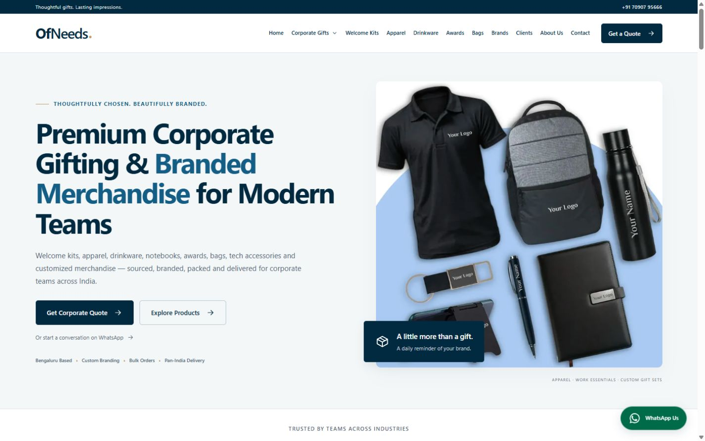
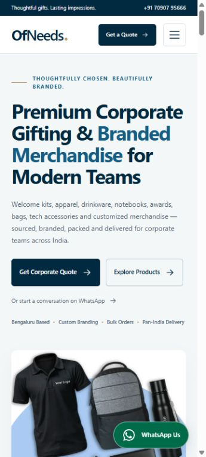

# OfNeeds website upgrade

Implemented in the existing project at `C:\Users\GirisH\Downloads\ofneeds-website\ofneeds-website`. The local preview is `http://localhost:5174/`. This is a local implementation; no production release, account change or domain change has been made.

## 1. Files created

Reusable Svelte components cover navigation, footer, SEO, product/category grids, client logos, testimonials, welcome kits, FAQs, quote forms, WhatsApp, approved brands and case studies. Typed data modules centralize business information, category pages and future editorial content. New routes, server-side lead handling, optimized images, environment examples and meaningful verification scripts have been added. The complete inventory is appended below.

## 2. Existing files modified

- `src/routes/+page.svelte`: premium corporate gifting homepage.
- `src/routes/+layout.svelte`: shared site shell, favicon and optional real verification tag.
- `src/routes/layout.css`: responsive navy/off-white design, keyboard focus, reduced motion and all shared layouts.
- `src/routes/sitemap.xml/+server.ts`: production canonical sitemap generated from public page and editorial data.
- `src/lib/assets/favicon.svg`: replaced the starter Svelte favicon with an OfNeeds gift icon.
- `static/robots.txt`: crawl allowance and production sitemap reference.

Existing packages, Bun lockfile, build commands, Amplify configuration, original static assets, contact details and Tally form URL are preserved. Original testimonials and product descriptions are retained in the data modules. Historical navigation/features/metrics are archived in `docs/legacy-data.json`.

## 3. Routes created

All thirteen requested landing pages exist with distinct buyer-oriented copy, metadata, enquiry CTAs, relevant products and related links:

| Route | Buyer requirement |
|---|---|
| `/corporate-gifting-bangalore` | Corporate gifting partner in Bengaluru |
| `/employee-welcome-kits-bangalore` | Employee onboarding and existing kit packages |
| `/corporate-tshirts-bangalore` | T-shirts and polos, sizing and branding |
| `/corporate-jackets-bangalore` | Jackets, hoodies and sweatshirts |
| `/corporate-drinkware` | Bottles, sippers and mugs |
| `/corporate-notebooks-diaries` | Notebooks, diaries and stationery |
| `/corporate-trophies-awards` | Corporate recognition and personalization |
| `/corporate-backpacks` | Backpacks, laptop bags and travel |
| `/tech-corporate-gifts` | Tech accessories and specification planning |
| `/employee-gifts` | Employee gifting occasions |
| `/client-gifts` | Client and executive gifting |
| `/event-merchandise` | Events, attendance and merchandise planning |
| `/festive-corporate-gifts` | Seasonal gift sets and delivery planning |

Additional public routes: `/corporate-apparel`, `/eco-friendly-corporate-gifts`, `/custom-gift-sets`, `/about`, `/clients`, `/brands`, `/contact`, `/insights`, `/privacy-policy` and `/terms-and-conditions`.

There are **24 public HTML pages**, including the existing homepage. `/brands/[slug]` and `/insights/[slug]` support future approved content. No empty individual brand or article pages are published. Unknown paths render the new 404 page with noindex metadata.

## 4. Homepage changes

The homepage now leads with “Premium Corporate Gifting & Branded Merchandise for Modern Teams,” rather than ₹599 pricing. The hierarchy follows the requested order: sticky navigation, premium hero, genuine client logos, twelve category cards, welcome kits, eight reasons to choose OfNeeds, five-step process, all eight existing products, optional approved projects/brands, all eight original testimonials, useful Bengaluru service copy, ten FAQs, enquiry form and multi-column footer.

The genuine ₹599 and ₹1099 packages retain their original inclusions. Starter and Essential labels identify those existing packages. Premium and Build Your Own are enquiry-based options without invented prices. The floating WhatsApp button uses the existing business number and the requested prefilled message. OfNeeds capitalization and “Gifts That Speak Your Brand” are consistent.

## 5. SEO changes

Every public page has a unique title and description, one H1, a production canonical URL, Open Graph and Twitter metadata. Useful landing-page copy explains product decisions, artwork, sizing, packaging and information buyers should supply. Related links connect relevant categories. Canonical URLs ignore query parameters, and trailing-slash variants redirect consistently. The sitemap is generated from the page registry and only approved editorial records. Robots.txt references the production sitemap.

Actual Google verification can be supplied through `GOOGLE_SITE_VERIFICATION`. Existing www/non-www and HTTPS hosting settings have not been changed. The default sharing image reuses the approved existing merchandise photograph through a central configuration.

## 6. Structured data

- Organization: OfNeeds, actual domain, existing email/phone, user-provided founding year and India service area.
- WebSite and BreadcrumbList on public pages.
- FAQPage matching the homepage’s visible questions and answers.
- Product/Offer for the two actual welcome-kit packages, using ₹599/₹1099 and INR without invented availability, ratings or reviews.

JSON-LD is valid JSON and escapes HTML-sensitive `<` characters. LocalBusiness markup is deferred until the full business-location details are confirmed. Generic category cards are not marked as exact priced products. Google no longer displays FAQ rich results; see [Google’s current updates](https://developers.google.com/search/updates).

## 7. Performance improvements

Responsive hero variants are 480, 800 and 1066 pixels. Product and logo WebP derivatives reduce the existing image collection from approximately **2.0 MB to 0.30 MB**, including the extra hero sizes—about **85% less image data** for that collection. Original assets remain available. The page prioritizes the hero, defers below-fold images and Tally, reserves image space and uses system fonts with no third-party font request. Shared components and normal SvelteKit route splitting limit unnecessary code.

The production CSS bundle is approximately 7.3 KB gzip. Core Web Vitals are ready for measurement, but no fabricated Lighthouse score or field-performance improvement is claimed.

## 8. Responsive and accessibility improvements

Desktop, tablet and mobile layouts have been reviewed at 1440, 768, 390 and 360-pixel widths. The mobile hero CTA sits above the fold, and the tested pages have no horizontal overflow. Navigation includes a hamburger menu, native category disclosure, keyboard dismissal and sufficiently sized controls. The native FAQ accordion works with keyboard interaction. Labels, meaningful alt text, visible focus, semantic landmarks, a skip link and reduced-motion support are provided. Category/product grids and quote inputs adapt to smaller screens.

## 9. Content still needed

Supply approved supplier brands, actual case studies, tech/executive/festive photography, full approved privacy/order policies, exact business address/hours/maps/social links, more specific quantity and delivery policies, owner-confirmed original metrics and editorial articles. These gaps are documented in `OWNER-SETUP.md`. No fictional projects, reviews, brands, partnerships, addresses or new prices have been published.

## 10. Environment and configuration

No environment change is required for the existing Tally flow. Without a configured receiver, the detailed form builds a WhatsApp brief and explicitly says it has not been sent. Optional `LEAD_WEBHOOK_URL` enables direct quotation submissions; optional `LEAD_WEBHOOK_TOKEN` authenticates server-to-server delivery. A success message appears only after the receiver acknowledges delivery. The endpoint needs durable acceptance, appropriate receiver-side rate limits and runtime configuration on Amplify. Logo uploads await approved storage. All lead fields and eight suggested CRM statuses are typed without building a CRM.

## 11. Manual Google Search Console steps

Verify the Domain property through Google’s DNS instructions, or the exact HTTPS www URL-prefix property using the real HTML verification value. For HTML verification, set `GOOGLE_SITE_VERIFICATION`, publish the approved version and confirm the tag in the live homepage. Submit `https://www.ofneeds.com/sitemap.xml`, inspect important URLs and monitor indexing/performance. See the detailed steps and official references in `OWNER-SETUP.md` and [Google’s verification guide](https://support.google.com/webmasters/answer/9008080).

## 12. Existing issues found and verification

The original site had inconsistent OfNeeds capitalization, a welcome-kit-price-led hero, a starter Svelte favicon, no mobile navigation, incomplete metadata/canonicals, a homepage-only request-host sitemap, no robots sitemap reference, large unoptimized images and a Tally-only enquiry experience. It had no verified supplier-brand registry, case-study records, lead backend, complete street address, full policies, analytics code or Search Console token in the inspected project.

Verification completed:

- Svelte compilation: all 22 components/pages, no issues.
- `npm run check`: zero TypeScript errors and zero Svelte warnings.
- `npm run build`: successful client/server build with the existing Amplify adapter.
- Lead validation: six passing tests for required values, email/phone, numeric bounds, dates, text limits, honeypot and receiver configuration.
- Local direct-submission integration: accepted delivery, structured payload, failed receiver, cross-origin rejection, request-size limit and malformed body rejection. No real leads sent.
- Site smoke checks: 24 public pages, 24 internal route targets, 19 referenced image URLs, 24 valid JSON-LD documents, 24 unique titles and descriptions; anchors, canonical/query behavior, trailing redirects, sitemap, robots and 404s passed.
- Browser review: mobile navigation, Escape dismissal, Tally loading, required-field validation, complete WhatsApp brief, FAQ accordion and representative desktop/tablet/mobile layouts. Browser logs showed no errors or warnings during these checks.

Real Tally submissions and real lead-receiver delivery still need an owner-approved production acceptance check. This implementation has not been deployed.

## 13. Phase 2

Publish genuine project stories and approved brands, add richer product photography/specifications, connect and verify the lead receiver/CRM, add approved file storage, publish useful authored buying guides and measure real conversion events and Core Web Vitals. Confirm the full local business details before extending location schema.

## Preview screenshots

Desktop and mobile screenshots are saved alongside this report.

## Complete file inventory

Created 63 files. The six modified existing files are listed in section 2.

- `.env.example`
- `docs/OWNER-SETUP.md`
- `docs/UPGRADE-REPORT.md`
- `docs/legacy-data.json`
- `docs/preview-desktop.jpg`
- `docs/preview-mobile.jpg`
- `src/lib/components/Brands.svelte`
- `src/lib/components/CaseStudies.svelte`
- `src/lib/components/CategoryGrid.svelte`
- `src/lib/components/Clients.svelte`
- `src/lib/components/Faq.svelte`
- `src/lib/components/Footer.svelte`
- `src/lib/components/Header.svelte`
- `src/lib/components/Icon.svelte`
- `src/lib/components/PageIntro.svelte`
- `src/lib/components/ProductGrid.svelte`
- `src/lib/components/QuoteForm.svelte`
- `src/lib/components/Seo.svelte`
- `src/lib/components/Testimonials.svelte`
- `src/lib/components/WelcomeKits.svelte`
- `src/lib/components/WhatsApp.svelte`
- `src/lib/data/catalog.ts`
- `src/lib/data/editorial.ts`
- `src/lib/data/image-sizes.json`
- `src/lib/data/legacy.ts`
- `src/lib/data/pages.ts`
- `src/lib/data/site.ts`
- `src/lib/seo.ts`
- `src/lib/server/leads.ts`
- `src/routes/+error.svelte`
- `src/routes/+layout.server.ts`
- `src/routes/+layout.ts`
- `src/routes/[slug]/+page.svelte`
- `src/routes/[slug]/+page.ts`
- `src/routes/brands/[slug]/+page.svelte`
- `src/routes/brands/[slug]/+page.ts`
- `src/routes/contact/+page.server.ts`
- `src/routes/contact/+page.svelte`
- `src/routes/insights/[slug]/+page.svelte`
- `src/routes/insights/[slug]/+page.ts`
- `static/optimized/amazon-logo.webp`
- `static/optimized/antstact.webp`
- `static/optimized/avo.webp`
- `static/optimized/back-bags.webp`
- `static/optimized/caps.webp`
- `static/optimized/eco-tote-bag.webp`
- `static/optimized/hero-1066.webp`
- `static/optimized/hero-480.webp`
- `static/optimized/hero-800.webp`
- `static/optimized/icon-192.webp`
- `static/optimized/infor.webp`
- `static/optimized/integrated-winzards.webp`
- `static/optimized/jacket.webp`
- `static/optimized/notebook.webp`
- `static/optimized/source.webp`
- `static/optimized/sri-value-tech.webp`
- `static/optimized/steel-sipper-bottle.webp`
- `static/optimized/trophy.webp`
- `static/optimized/tshirt.webp`
- `static/optimized/valzy.webp`
- `tests/lead-integration.mjs`
- `tests/lead-validation.test.mjs`
- `tests/site-smoke.mjs`
